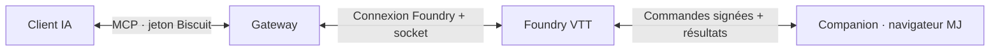

<div align="center">


# MCP Gateway Companion pour Foundry VTT

**Faites participer votre assistant IA à l'expérience Foundry en direct.**

Le composant navigateur de **[MCP Gateway](https://github.com/wanoo/foundry-mcp-gateway)** :
lire les valeurs des fiches, examiner une scène, lancer les dés natifs et interagir avec les joueurs.
Installez Gateway et Companion ensemble pour profiter de l'application complète.

[](https://foundryvtt.com)
[](LICENSE)

[English](README.md) · [Installation complète](https://github.com/wanoo/foundry-mcp-gateway/blob/main/docs/installation.fr.md) · [Discussions](https://github.com/wanoo/foundry-mcp-gateway/discussions)

</div>

## Préparer avec ce qu'affiche réellement Foundry

Le Gateway travaille avec les documents du monde. Le Companion lui ajoute les
API du navigateur Foundry : valeurs préparées des personnages, scène visible,
moteurs de dés natifs et interfaces des modules. Par exemple :

> « Lis les caractéristiques finales du PNJ sélectionné, avec ses effets actifs, et résume ce dont j'ai besoin pour la rencontre. »

> « Examine cette scène et décris ses tokens, ses portes et ses lumières avant que je prépare la prochaine rencontre. »

> « Demande aux joueurs quelle piste ils veulent suivre, puis résume leurs réponses pour mes notes de préparation. »

En partie, il peut aussi ouvrir une illustration, déplacer la caméra, lancer
des dés ou déclencher une ambiance. Le Companion 1.8 traite **56 outils compagnon**,
tous inclus dans le catalogue du Gateway. Votre IA se connecte au Gateway ;
le Companion n'expose pas de point d'accès MCP séparé.

| Usage | Exemples | Dépendances facultatives |
|---|---|---|
| Comprendre le monde | Valeurs des fiches, rapports de scène, captures, compendiums traduits | Babele pour les traductions |
| Interagir avec les joueurs | Questions et réponses, notifications, documents, cibles et caméra | Aucune pour les actions de base |
| Lancer les dés dans Foundry | Formules natives ; pools Star Wars FFG natifs | Système correspondant ; Dice So Nice pour les dés 3D |
| Préparer la campagne | Fiches, tableau des quêtes, dates, ressources étiquetées | Campaign Codex, Mini Calendar, Asset Librarian |
| Préparer scènes et butin | Coffres, tas de butin et marchands ; préfabriqués posés ou enregistrés sur une scène | Item Piles (avec son intégration système), Mass Edit |
| Mettre en scène | Météo, effets, filtres de tokens, musique et tuiles actives | FXMaster, Sequencer, Token Magic FX, Mini Player ou Monk's Active Tiles selon l'action |

Consultez le [catalogue complet et ses dépendances](https://github.com/wanoo/foundry-mcp-gateway/blob/main/docs/capabilities.fr.md).
Une intégration indisponible indique le module manquant.

## Une application, deux composants



Le **Gateway** fonctionne en conteneur Docker ou en binaire natif. Ce **Companion**
fonctionne comme module Foundry dans le navigateur MJ. Un MJ doit être connecté
avec un onglet actif pour que ses outils répondent ; une connexion de bot sans
navigateur n'est pas un répondant. Les actions destinées aux joueurs nécessitent
aussi que ces joueurs soient connectés avec le module chargé. Le Gateway peut
travailler sur les documents sans Companion ni navigateur MJ connecté.

Le Companion déclare **Foundry v12 minimum** et **v14 vérifiée**. La paire 1.8 a
été testée sur **Foundry 14.369** ; cela ne certifie pas chaque ancien build.
Le Gateway vise les v13 et v14.

## Installer et établir la confiance

Vous découvrez l'application ? Suivez le **[guide d'installation complet](https://github.com/wanoo/foundry-mcp-gateway/blob/main/docs/installation.fr.md)**
pour configurer le Gateway, générer les clés et connecter votre IA.

1. Dans **Modules complémentaires → Installer un module → URL du manifeste**, collez :

   ```text
   https://github.com/wanoo/foundry-mcp-gateway-companion/releases/latest/download/module.json
   ```

2. Activez **Foundry MCP Companion** dans le monde et gardez un navigateur MJ ouvert.
3. Configurez une `COMPANION_SIGNING_KEY` stable sur le Gateway, générée avec `foundry-mcp --generate-key`.
4. Demandez à votre IA d'appeler `companion_trust_key` pour ce monde.
5. **Rechargez tous les navigateurs MJ**, puis appelez `client_status` pour vérifier le répondant et les versions.

La méthode manuelle consiste à coller la sortie de `foundry-mcp --print-public-key`
du Gateway dans **Configurer les paramètres → Foundry MCP Companion → Clé publique
de la passerelle**, puis à recharger les navigateurs MJ. L'outil refuse d'écraser
une autre clé déjà présente : examinez l'écart avant de la remplacer. Ouvrez
Foundry en HTTPS ou sur le localhost du navigateur pour vérifier les signatures
avec Web Crypto.

Gardez Gateway et Companion sur le même **majeur.mineur**, par exemple 1.8.x.
Les correctifs peuvent différer. L'URL du manifeste installe le dernier
Companion publié.

## Accès et réglages

**Les jetons Biscuit protègent l'accès client IA → Gateway.** Le Gateway les
crée ; ils permettent expiration, lecture seule et révocation individuelle.
Gardez l'URL MCP complète privée. Les jetons Biscuit ne sont pas les clés de
signature du Companion.

**Les signatures ECDSA P-256 authentifient les commandes Gateway → Companion.**
Configurez la clé de signature stable du Gateway et installez sa partie publique
dans le monde.

| Réglage | Défaut | Rôle |
|---|---|---|
| Vérification de signature des commandes | Protégée / Guarded | Sans clé, refuse les commandes exécutant du code ; avec une clé, exige des signatures valides partout |
| Clé publique de la passerelle | Vide | Clé de confiance installée à la configuration ; les changements prennent effet après rechargement |
| Exécution de script distante | Désactivée | Contrôle le JavaScript arbitraire de `client_run_script` ; modes facultatifs avec confirmation ou automatique |
| Exécution distante de macros de script | Demander confirmation | Réglage distinct pour les macros de script invoquées à distance ; celles lancées manuellement restent inchangées |
| Relayer la télémétrie des clients | Activé, par client | Rapporte sélections, cibles et scène ; chaque client peut le désactiver |

Le mode strict refuse les commandes non authentifiées même sans clé configurée ;
le mode désactivé supprime la vérification. L'accord d'exécution du script reste
un choix distinct. Les signatures ne chiffrent pas les réponses sur le canal
socket partagé du module. `client_enrich` exclut les secrets MJ par défaut ; les
demander explicitement les transmet sur ce canal partagé. Consultez le
[guide de confiance et de configuration](https://github.com/wanoo/foundry-mcp-gateway/blob/main/docs/advanced.fr.md#accès-et-confiance-du-companion).

## Versions récentes

**La 1.8 prépare scènes et butin** avec Item Piles et Mass Edit, et ferme les
chemins de code cachés dans les données : tuiles actives, scripts de région,
scripts de presets et macros de piles suivent désormais les réglages de script
de ce module, et les changements de ces réglages faits par un client qui ne
charge pas le module (comme la Gateway) sont annulés.

**La 1.6 a introduit l'authentification des commandes** et l'accord distinct pour
les macros de script. **La 1.7 enrichit la préparation** avec Campaign Codex 6.9,
Mini Calendar 10, la recherche Asset Librarian et Mini Player, ainsi que des
correctifs de ciblage et de son Foundry 14. Conservez vos clés depuis la 1.6,
rechargez les navigateurs et reconnectez le client MCP. Pour les versions plus
anciennes, suivez la [migration depuis la 1.5](https://github.com/wanoo/foundry-mcp-gateway/blob/main/docs/advanced.fr.md#mises-à-jour).

## Aide et contributions

- [Dépannage](https://github.com/wanoo/foundry-mcp-gateway/blob/main/docs/advanced.fr.md#dépannage) — délais dépassés, signatures et modules absents.
- [Discussions](https://github.com/wanoo/foundry-mcp-gateway/discussions) — aide commune et préparation de campagne.
- [Signaler un bug Companion](https://github.com/wanoo/foundry-mcp-gateway-companion/issues) · [Signaler un bug Gateway](https://github.com/wanoo/foundry-mcp-gateway/issues).
- [Contribuer](https://github.com/wanoo/foundry-mcp-gateway-companion/blob/main/CONTRIBUTING.md) · [Changelog](https://github.com/wanoo/foundry-mcp-gateway-companion/blob/main/CHANGELOG.md) · [Politique de sécurité](https://github.com/wanoo/foundry-mcp-gateway-companion/blob/main/SECURITY.md), en anglais.

[Licence MIT](LICENSE). Projet indépendant, sans affiliation avec Foundry Gaming LLC.
