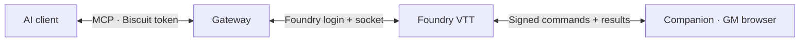

<div align="center">


# MCP Gateway Companion for Foundry VTT

**Bring your AI assistant into the live Foundry experience.**

The browser component of **[MCP Gateway](https://github.com/wanoo/foundry-mcp-gateway)**:
read the values on your sheets, inspect a scene, roll native dice and interact with players.
Install Gateway and Companion together for the full application.

[](https://foundryvtt.com)
[](LICENSE)

[Français](README.fr.md) · [Full setup guide](https://github.com/wanoo/foundry-mcp-gateway/blob/main/docs/installation.md) · [Discussions](https://github.com/wanoo/foundry-mcp-gateway/discussions)

</div>

## Prepare with what Foundry actually shows

The Gateway works with your world's documents. The Companion adds the APIs
running inside Foundry's browser: prepared character values, the visible canvas,
native roll engines and addon interfaces. For example:

> “Read the selected NPC's final stats, including active effects, and summarize what I need for the encounter.”

> “Inspect this scene and describe the tokens, doors and lights before I stage the next encounter.”

> “Ask the players which lead they want to follow, then summarize their answers for my preparation notes.”

During play, it can also open a handout, pan a camera, roll dice or cue an ambience.
The 1.7 Companion handles **46 companion tools**, all included in the Gateway's
catalogue. Your AI connects to the Gateway; the Companion exposes no separate
MCP endpoint.

| Use | Examples | Optional dependencies |
|---|---|---|
| Understand the world | Prepared sheet values, scene reports, screenshots, translated compendia | Babele for translations |
| Interact with players | Questions and answers, notifications, documents, targets and camera | None for the basic actions |
| Roll in Foundry | Native formula rolls; native Star Wars FFG pools | The matching system; Dice So Nice for 3D dice |
| Prepare campaign content | Campaign sheets, quest board, calendar dates, tagged assets | Campaign Codex, Mini Calendar, Asset Librarian |
| Stage the scene | Weather, effects, token filters, music and active tiles | FXMaster, Sequencer, Token Magic FX, Mini Player or Monk's Active Tiles, depending on the action |

See the [complete catalogue and dependencies](https://github.com/wanoo/foundry-mcp-gateway/blob/main/docs/capabilities.md).
An unavailable integration reports which module is missing.

## One application, two components



The **Gateway** runs as a Docker container or native binary. This **Companion**
runs as a Foundry module in the GM's browser. A GM must be connected with an
awake tab for Companion tools to answer; a headless bot connection is not a
browser responder. Player-facing actions also need the intended players connected
with the module loaded. The Gateway can still work on documents without the
Companion or a connected GM browser.

The Companion declares **Foundry v12 minimum** and **v14 verified**. The paired
1.7 application was tested on **Foundry 14.369**; this does not certify every
older build. The Gateway targets v13 and v14.

## Install and establish trust

New to the application? Follow the **[complete installation guide](https://github.com/wanoo/foundry-mcp-gateway/blob/main/docs/installation.md)**
to configure the Gateway, generate keys and connect your AI first.

1. In **Add-on Modules → Install Module → Manifest URL**, paste:

   ```text
   https://github.com/wanoo/foundry-mcp-gateway-companion/releases/latest/download/module.json
   ```

2. Enable **Foundry MCP Companion** in your world and keep a GM browser open.
3. Configure a stable `COMPANION_SIGNING_KEY` on the Gateway, generated with `foundry-mcp --generate-key`.
4. Ask your AI to call `companion_trust_key` for this world.
5. **Reload all GM browsers**, then call `client_status` to check the responder and versions.

The manual alternative is to paste the Gateway's `foundry-mcp --print-public-key`
output into **Configure Settings → Foundry MCP Companion → Gateway public key**,
then reload GM browsers. The trust tool refuses to overwrite a different existing
key; inspect the mismatch before replacing it. Use Foundry over HTTPS or browser
localhost so Web Crypto can verify signatures.

Keep Gateway and Companion on the same **major.minor**, such as 1.7.x. Patch
numbers may differ. At the publication check on 16 October 2026, both
[Gateway](https://github.com/wanoo/foundry-mcp-gateway/releases/latest) and
[Companion](https://github.com/wanoo/foundry-mcp-gateway-companion/releases/latest)
were published as 1.6.0; this source tree documents the upcoming 1.7.
The manifest URL installs the latest published Companion.

## Access and settings

**Biscuit tokens protect AI client → Gateway access.** The Gateway creates them;
they support expiry, read-only access and individual revocation. Keep the full
MCP connection URL private. Biscuit tokens are not the Companion's signing keys.

**ECDSA P-256 signatures authenticate Gateway → Companion commands.** Set the
Gateway's stable signing key and install its public half in the world.

| Setting | Default | Purpose |
|---|---|---|
| Command signature checking | Guarded | Without a key, refuses code-executing commands; with a key, requires valid signatures for every command |
| Gateway public key | Empty | Trust anchor installed during setup; changes take effect after browser reload |
| Remote script execution | Disabled | Controls arbitrary JavaScript from `client_run_script`; optional ask-first or automatic modes |
| Remote script-macro execution | Ask me first | Separate policy for remotely invoked script macros; manually launched macros are unaffected |
| Relay client telemetry | On, per client | Reports selections, targets and scene state; each client can turn it off |

Strict signature mode refuses unauthenticated commands even when no key is set;
off mode disables checking. Script approval is a separate choice from signature
checking. Signatures do not encrypt replies on Foundry's shared module socket
channel. GM secrets in `client_enrich` are excluded by default; explicitly
requesting them sends them over that shared channel.
See the [trust and configuration guide](https://github.com/wanoo/foundry-mcp-gateway/blob/main/docs/advanced.md#access-and-companion-trust).

## 1.6 to 1.7

**1.6 introduced command authentication** and separate script-macro approval.
**1.7 improves campaign preparation** with Campaign Codex 6.9, Mini Calendar 10,
Asset Librarian search and Mini Player, alongside Foundry 14 targeting and sound
fixes. Retain existing keys when updating from 1.6, reload browsers and reconnect
your MCP client. For older versions, follow the separate
[1.5 migration instructions](https://github.com/wanoo/foundry-mcp-gateway/blob/main/docs/advanced.md#upgrading).

## Help and contribute

- [Troubleshooting](https://github.com/wanoo/foundry-mcp-gateway/blob/main/docs/advanced.md#troubleshooting) — timeouts, signatures and missing modules.
- [Discussions](https://github.com/wanoo/foundry-mcp-gateway/discussions) — shared setup help and campaign workflows.
- [Report a Companion bug](https://github.com/wanoo/foundry-mcp-gateway-companion/issues) · [Report a Gateway bug](https://github.com/wanoo/foundry-mcp-gateway/issues).
- [Contribute](https://github.com/wanoo/foundry-mcp-gateway-companion/blob/main/CONTRIBUTING.md) · [Changelog](https://github.com/wanoo/foundry-mcp-gateway-companion/blob/main/CHANGELOG.md) · [Security policy](https://github.com/wanoo/foundry-mcp-gateway-companion/blob/main/SECURITY.md).

[MIT licensed](LICENSE). Independent project, not affiliated with Foundry Gaming LLC.
